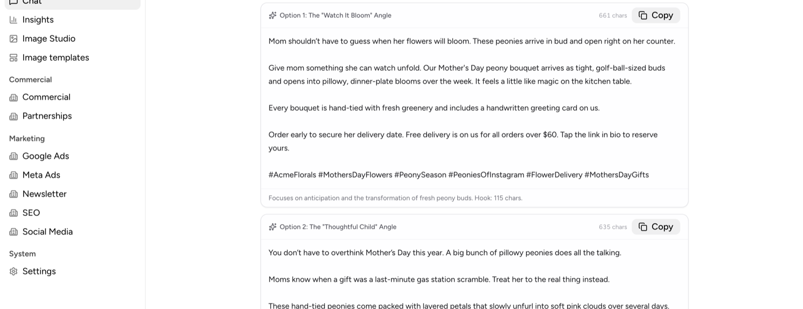
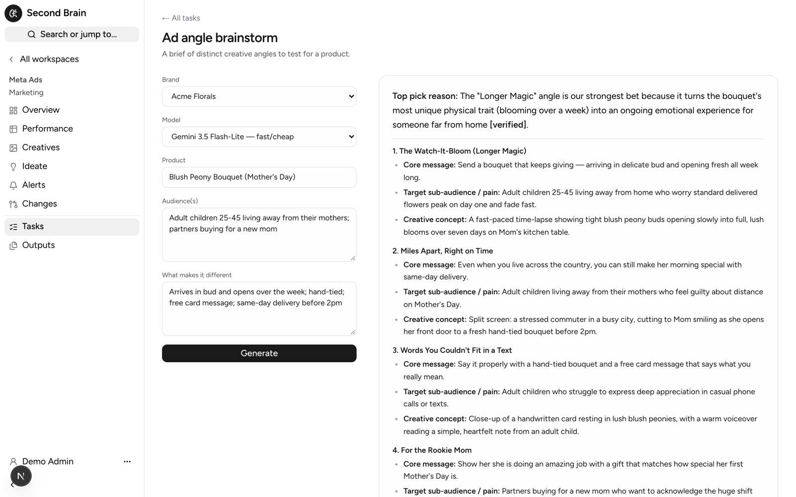
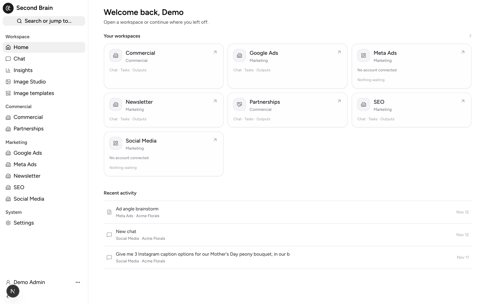
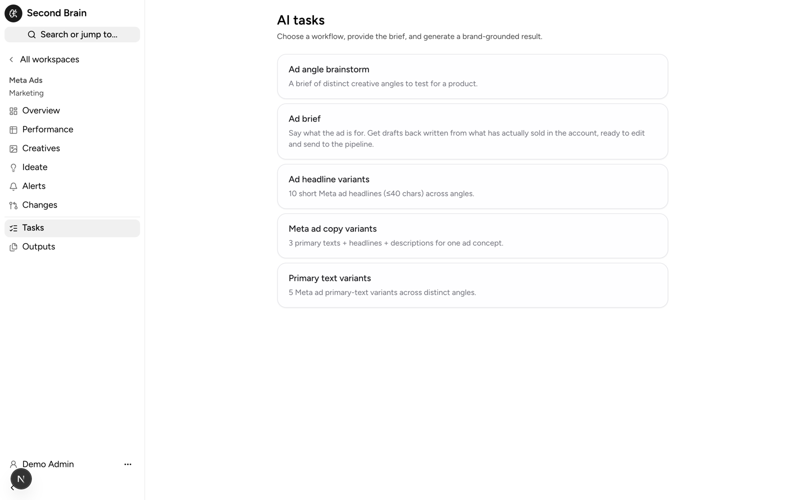
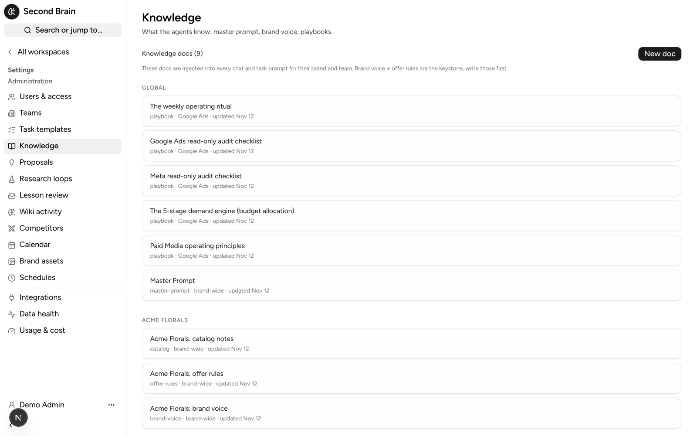

# Second Brain

A multi-brand, multi-team AI workspace for marketing and commercial teams. Every
chat, task and image is grounded in the selected brand's own knowledge: its
voice, offer rules, catalog, playbooks and the campaigns that actually worked.

Built for a group running several ecommerce brands across four markets, then
generalised. The demo ships with three fictional brands: **Acme Florals**,
**Bloomly** (PH, SG, TH, VN) and **Northwind Audio**.

Stack: Next.js 16 (App Router, React 19) · Auth.js v5 (Google) · Neon Postgres +
Drizzle · Vercel AI SDK v6 with direct Anthropic, OpenAI and Google providers ·
Astryx design system + Tailwind v4 · S3-compatible storage (R2) or Vercel Blob.



## What it does

**Brand-grounded agents.** `src/lib/prompt.ts` assembles one system prompt per
brand and team in a fixed, cache-friendly order: global master prompt, brand-wide
docs (voice, offer rules, catalog), team playbooks, then up to five recent proven
winners. Chat and task runs share it, so a task and a follow-up chat say the same
thing. Above, the caption's free-delivery threshold and free greeting card come
from the brand's offer rules and catalog docs, not from the question.

**Task templates.** Admins define forms (`inputFields`) and a `{{variable}}`
prompt per team. Runs stream, are saved, can be reviewed by a second model and
continued in chat. Output can render as prose, a structured report, or an ad
brief that writes drafts straight into the ads queue.



**Live data tools.** Per-brand encrypted connections (AES-256-GCM) to Meta Ads,
Meta organic (Page + Instagram), Google Ads, GA4, Search Console via BigQuery,
Merchant Center, TikTok (organic + ads), Shopify, SendPulse and Ahrefs. The agent
gets only the tools for what that brand has connected, and every write (pause an
ad, change a product title, edit the CMS) waits behind an **Apply** card a human
clicks.

**Workspaces.** Teams are declared in one registry (`src/lib/workspaces.ts`):
tabs, platform scope, prompt focus and capabilities. Built-in workspaces:

| Workspace | What it adds |
|---|---|
| Meta Ads | Performance, creative analytics (AI-classified creatives, win rate), alerts and rules, a change log, ideation |
| Social Media | Multi-brand post calendar, drafts queue, approve-then-publish to Facebook, Instagram, TikTok |
| SEO | Search Console tools, storefront sitemap and feed history, AI search visibility tracker (ChatGPT, Gemini, Claude) |
| Newsletter | Block-based email builder from a brief and the live product feed |
| Partnerships | Partner outreach tracker with a follow-up ladder and AI-drafted emails |
| Google Ads, Commercial | Dashboards, Merchant Center title proposals, CMS tools over MCP |





**Image studio.** GPT Image, Gemini and others behind one interface, reusable
brand assets as references, saved prompt templates in folders, GIF and SVG
output.

**A learning loop.** The knowledge base is a small wiki the agent maintains:
scheduled jobs reflect on recent runs, propose new docs or edits for an admin to
approve, and lint for contradictions (`src/lib/wiki`, `src/lib/loops`,
`src/lib/proposals`). No RAG: the knowledge that matters fits in the prompt and
is cached.



**Access control.** Google sign-in against an allowlist (the `users` table).
`src/lib/access.ts` is the single authorisation layer: `requireUser`,
`requireAdmin`, `requireTeam` for pages and actions; `apiUser`, `apiTeam` for
routes. Admins see every team; members need a grant. Removing a user revokes
access on the next request.

## Quick start

You need Node 24, a Postgres database (a free [Neon](https://neon.tech) project
works) and a Google OAuth client.

```bash
git clone https://github.com/rodrig0055/second-brain && cd second-brain
npm install
cp .env.example .env.local     # fill in DATABASE_URL, AUTH_*, one AI key, SEED_ADMIN_EMAIL
openssl rand -base64 32        # use as AUTH_SECRET
npm run db:push                # create the tables
npm run db:seed                # demo brands, teams, brand docs, starter templates, your admin
npm run dev
```

Google OAuth: create a Web client at console.cloud.google.com and add
`http://localhost:3000/api/auth/callback/google` as a redirect URI.

Sign in with the `SEED_ADMIN_EMAIL` account. Anyone not in Admin, Users is
refused at sign-in.

Optional demo data:

```bash
set -a && . ./.env.local && set +a
npx tsx scripts/seed-competitors.ts
npx tsx scripts/seed-ai-search.ts
npx tsx scripts/seed-marketing-templates.ts
```

Every integration is optional. With none connected the app is chat, tasks and
images; each connection you add in Admin, Integrations unlocks its tools and
dashboards for that brand.

## Making it yours

1. Replace the demo brands in `src/db/seed.ts` (or in Admin) with your own.
2. Admin, Knowledge: per brand, a **Brand voice** and an **Offer rules** doc,
   then 5 to 10 **Winner** docs (past work that performed, and why). This is
   what makes the output good.
3. Admin, Users: add teammates and grant teams.
4. Admin, Templates: edit the starter tasks or add your own.
5. Teams and their tabs live in `src/lib/workspaces.ts`.

## Deploy

Vercel works out of the box (`vercel.json` holds the daily crons; the Hobby plan
allows daily schedules only). Add every variable from `.env.local`, plus
`CRON_SECRET`, and add the production redirect URI to the OAuth client.
Schema changes are push-based: edit `src/db/schema.ts`, then `npm run db:push`.

## Development

```bash
npm run lint
npx tsc --noEmit
npm test                                   # node:test unit tests
python3 -m unittest tests/test_meta_insights.py
```

CI (`.github/workflows/pr-checks.yml`) runs all four plus a production build on
every pull request, with placeholder secrets only.

This uses **Next.js 16**: middleware lives in `src/proxy.ts`, and APIs differ
from older versions. Read `node_modules/next/dist/docs/` before changing
framework code.

## Layout

```
src/app/(app)/      authenticated UI: /chat, /images, /insights, /admin/*, /t/[team]/*
src/app/api/        streaming chat and task routes, crons, OAuth callbacks
src/lib/prompt.ts   system prompt assembly
src/lib/access.ts   authorisation
src/lib/integrations/   one folder per platform: client, sync, agent tools
src/lib/tools/      the agent's tool sets
src/db/schema.ts    the whole data model
api/meta-insights.py    Python function bridging Meta's Ads CLI
```

## License

MIT. See [LICENSE](LICENSE) and [THIRD_PARTY_NOTICES.md](THIRD_PARTY_NOTICES.md).
